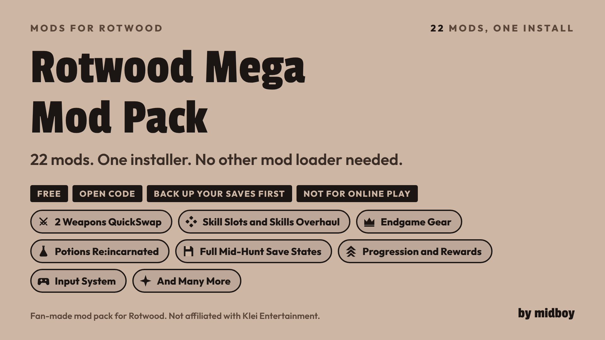
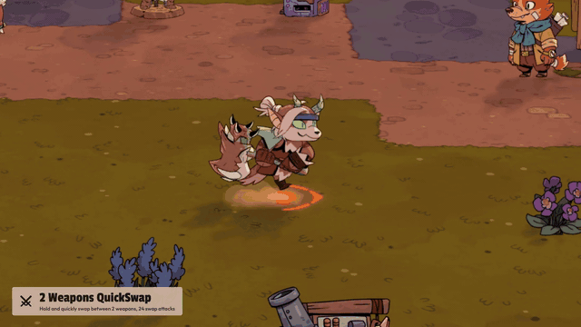
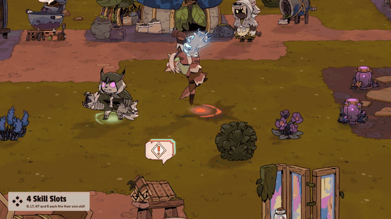
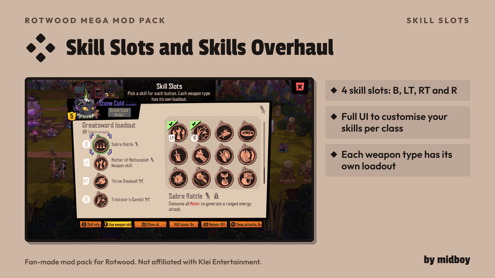
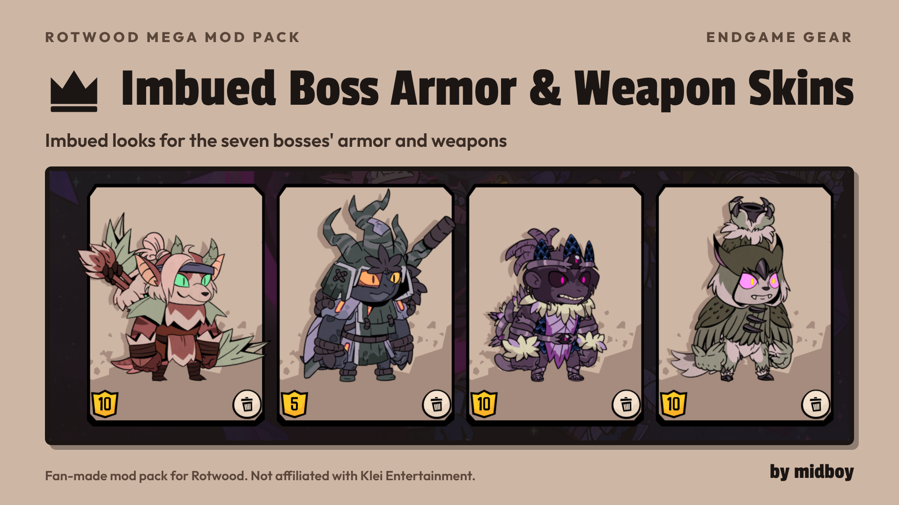
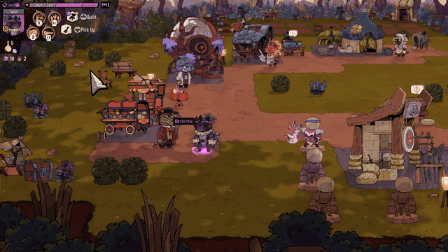
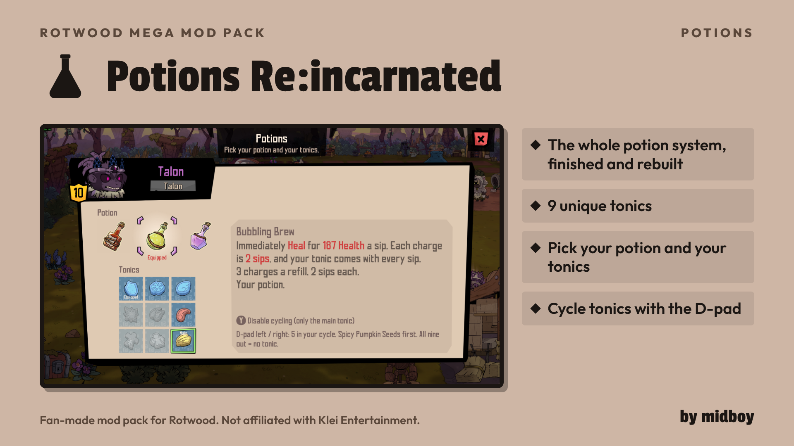
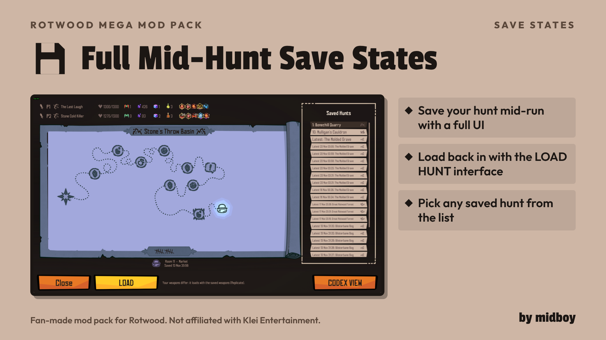
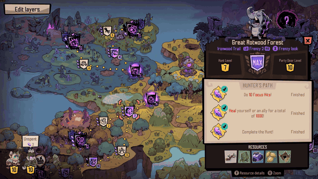

# Rotwood Mega Mod Pack

24 mods for Rotwood in one download, with their own small mod loader and a one-click installer.

**Fan-made. Not made, endorsed or supported by Klei Entertainment.** Rotwood has no official mod support, so mods are at your own risk.

- **Free.** No paid content.
- **Open code.** Every mod, the loader and the installer are plain text in this repository.
- **Your saves are backed up** by the installer before anything changes.
- **Do not use online.** Online play has not been tested.

Designed, directed and playtested by midboy. The code was written with AI assistance (Claude).

## Download

Get the latest zip from the [Releases](../../releases) page.

## Features

### 2 Weapons QuickSwap
- Hold and quickly swap between 2 weapons with 24 swap attacks (4 for each of the 6 weapon types).
- Swap out of any dodge, attack or skill to chain weapons mid-combo.
- Each weapon keeps its own meter, ammo and cooldowns.

### Skill Slots and Skills Overhaul
- 4 skill slots, with a full UI to customise your skills per weapon class.
- Balance overhaul: weak skills buffed, strong skills given charges.

### Endgame Gear
- Imbued boss gear: weapons and armor.
- Passive effects for all 7 special boss weapons.

### Potions Re:incarnated
The entire potion system, finished and re-implemented in the game.
- 9 unique tonics, cycled mid-hunt with the D-pad.
- A new camp NPC with his own potion station and UI.

### Full Mid-Hunt Save States
- Save your hunt mid-run with a full-screen SAVE HUNT menu.
- Load back into that hunt from the LOAD HUNT menu.

### Progression and Rewards
Completely configurable.
- Frenzy up to Super Frenzy 5 on side hunts, for max corestones and max difficulty.
- More weapon power rooms and more Fabled rooms.
- More rewards and a higher cosmetic drop chance.
- Easier boss gear grind.

### Input System
- Every control feature works for up to 4 local players.
- Dedicated buttons for skills.
- Right stick easy emotes.
- Twin-stick combat mode.
- Tonic cycling on the D-pad.

### And more
- Presets and loadouts that remember all of your choices and builds.
- New weapon moves, armor dyes, player colours, faster loading and quality-of-life fixes.
- Cannon Tweaks: the cannon's weapon powers retuned, with every number a setting.
- Powers First: NPCs and meals switch off while a power is waiting to be picked.

## Install

Windows, Steam version of Rotwood. Made for game build 763742.

1. Download the zip from Releases and unpack the whole thing into a folder.
2. Close Rotwood.
3. Double-click `Install.bat`.
4. Start Rotwood.

`Check.bat` only reports what it finds and changes nothing. The full walkthrough, including every message the installer can show, is in [docs/INSTALL.txt](docs/INSTALL.txt).

The installer changes two things: it adds one line to `scripts/main.lua` inside the game's `data_scripts.zip` (the original is kept next to it), and it copies the mods to your Rotwood mods folder. No internet, no registry, no admin rights.

**After a game update** Steam puts the original game file back and the mods go quiet. Run `Install.bat` again.

**Uninstall:** close Rotwood and run `Uninstall.bat`. Steam's "Verify integrity of game files" also restores the original game file at any time.

It cannot be used together with another Rotwood mod loader.

## Settings

Every mod has its own settings file. [docs/SETTINGS_GUIDE.txt](docs/SETTINGS_GUIDE.txt) lists every setting, what it does and which file it is in.

## What is in this repository

| Folder | Contents |
|---|---|
| `source/` | The installer (`Install.bat`, `Uninstall.bat`, `Check.bat`, `files/modpack.ps1`), the loader (`files/nativeloader.lua`) and every mod's Lua source and README. |
| `docs/` | Installation steps and the settings guide. |
| `images/` | Page images and clips. |

The art archives (animation files for Armor Dyes, Tonic Swap, Camp Brother and Weapon Moves) are only in the release zip, not in `source/`.

## Bugs

Open an issue and attach `client_log.txt` from `%APPDATA%\Klei\Rotwood\steam-<your id>\`.

## Credits

Mods and loader by midboy. Rotwood is by Klei Entertainment.
